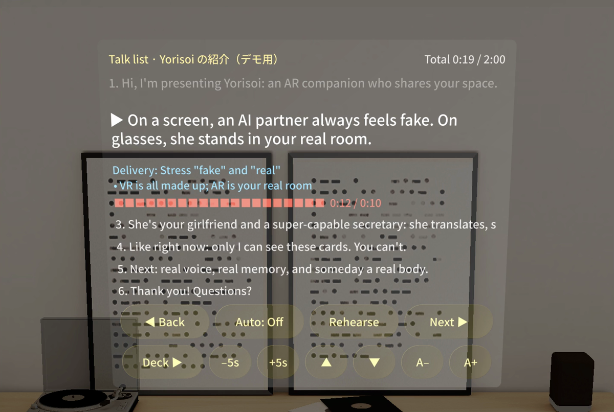
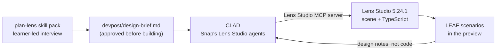

# Yorisoi

**An AR companion for Snap SPECS who stays in front of you while you work, sees the page you're looking at, and helps you read what you can't.**

*Yorisoi* (寄り添い) means "staying close beside someone." Made for the Devpost hackathon [Learn AR with SPECS](https://learn-specs.devpost.com/) by **Xinogi Studio (しのぎ)**.

<!-- TODO: capture docs/images/hero.png (see devpost/portfolio/assets-todo.md) -->


*Hero image: TBD.* · **Demo video:** TBD (YouTube, under 3 minutes)

Lens Studio 5.24.1 · SPECS · TypeScript · Spectacles Interaction Kit + UI Kit · LEAF

> **Status:** work in progress for the hackathon. The final character clips, the LEAF test results and the demo video are still TBD. The character in the project right now is a placeholder.

---

## What it does

You sit at your desk and work. She is there with you, in your real room.

- **She stays in front of you.** A life-size companion (about 165 cm) stands about 2.5 m away, a little to the right of your desk work so she never covers it, and does her own idle things. Turn your head and she lazily follows: once she ends up more than about 12° off her spot, she glides back into view within about 1.4 s, even if you turned all the way around.
- **She checks in on you.** After a quiet stretch (20 s in the default mode), she walks closer and teases you a little: *"What are you working on? Anything I can help with?"*
- **Call her.** Pinch the big **Call** button on the desk. She says *"What's up?"* and walks up to about 1.2 m in front of you.
- **Ask about a word.** Pinch a highlighted word on the foreign-language page on your desk: English (*serendipity*, *ephemeral*), Korean (*날씨*, *감사합니다*) or hard kanji (*薔薇*, *憂鬱*, *檸檬*, *齧る*). The reading and meaning appear **right next to the word** (and fade after 8 s), and she explains it.
- **Hand her a book.** Grab the book on the desk, *Alice's Adventures in Wonderland* (Lewis Carroll, 1865, public domain), and hold it out to her. She opens it, reads, and tells you a short summary.
- **Dance or pose.** When she is close, **Dance** and **Pose** buttons appear next to her (cute and fun, never sexual).
- **Switch her mode.** Sweetheart (default), Smart, Secretary, Cue cards, Dance and Healing. Each mode changes her lines, how often she comes over, how much she moves around and which clips she favors. All of it lives in one editable file, [`persona/modes.md`](persona/modes.md).
- **Cue cards.** In Cue cards mode she holds your talking points as big, light cards right beside her. Pinch **Next** / **Back** to move through them. On the last card she says *"You did great!"*
- **Voice and subtitles.** She speaks English (pre-recorded TTS voice lines) with **Japanese and English subtitles** in a speech bubble beside her head. Her voice and footsteps are spatial audio, so you hear where she stands.

Translation works in every mode, because it is the most useful help she gives. She only helps with words, cards, dancing and company. She has no body, so she never offers to fetch things.

## Why glasses

- **She is in your real space.** On a phone, laptop or in VR, everything around a companion is made up, so you think "this isn't real." On SPECS she stands in your actual room, next to your actual desk.
- **She shares your view.** She talks about the page you are looking at, and the answer lands on the page itself, not on a floating panel.
- **Your hands and eyes stay on your work.** You keep working; she lives inside the glasses' narrow view instead of on a second screen.
- **The display does part of the work.** SPECS uses an additive display, where black renders as transparent. Her clips are filmed on pure black and shown on a camera-facing card with additive blending, so the black disappears and only she remains in the room. Her clothes, the text and the UI are kept light so they stay visible.

## How it was built



1. **Plan: plan-lens.** The [plan-lens skill pack](.claude/skills/plan-lens/SKILL.md) interviewed the learner (in Japanese), checked each answer against AR design habits and against what Lens Studio's preview can do, and wrote [`devpost/design-brief.md`](devpost/design-brief.md). The learner made every decision, and the brief was approved before any building started.
2. **Build: CLAD through the Lens Studio MCP server.** CLAD, Snap's Lens Studio agent toolkit, read the brief and built the scene, the SIK / UI Kit interactions and the TypeScript behavior scripts in Lens Studio 5.24.1, working through the Lens Studio MCP server.
3. **Test: LEAF.** One LEAF scenario per done criterion in the brief, run in the Lens Studio preview. Results are TBD ([table below](#leaf-tests)).
4. **Iterate with design notes.** Changes go back to the agent in design terms, then the tests run again. For example: *"If I'm working at my desk, I want her always in front of my view. I don't want her behind me."* That note became the lazy head-follow in `DeskCompanionController`.

### How the AI-agent workflow went (honestly)

- **Planning first paid off.** Because the brief already said where everything lives (in centimeters), what the preview stand-ins are and what "done" means, the first CLAD build already contained the whole flow: Call button, pinchable words, grabbable book, tease-after-idle, come-when-called, dance and pose, speech bubble with subtitles and spatial audio. The follow-up changes so far have been targeted design notes.
- **Decisions stayed human.** The agents never chose her look, her personality or the modes. When the plan changed (for example from a true-3D model to a photoreal video character, and from "she roams the room" to "she always stays in front"), the change was written back into the brief first.
- **The MCP connection looked dead, but it wasn't.** Lens Studio's MCP server was running, yet every reply failed in the agent's HTTP client. The cause turned out to be a local antivirus web shield that rewrote loopback HTTP responses: it declared chunked transfer encoding without chunk framing and kept the connection open. We confirmed it by sending a correct response from our own test server and getting the same corruption back. The fix was a small **stdio bridge** (`tools/ls_mcp_bridge.py`, being added to this repo). Claude Code talks to it over stdio, and it forwards each JSON-RPC message to Lens Studio over a raw socket and reads the reply tolerantly (plain JSON, real chunked or SSE). It reads the session token from the project's `.mcp.json` on every request, because Lens Studio rewrites that file at each start. Nothing secret is stored in the script and nothing is logged. The agent still talks to Lens Studio **only through the MCP tools**: the bridge fixes the transport and bypasses nothing.
- **Plugins need trust.** The Lens Studio AI plugins (LEAF, AI Assistant, Agents-Docs) download after the first launch and only load after a restart and a permission prompt for each plugin. Until then there are no MCP tools at all.
- **Some things only real glasses can tell.** No SPECS device was available. Everything here is "logic proven" at best in the preview. Comfort over a long work session with someone always in front of you, real hand tracking, real speech recognition, and real furniture hiding her (needs the Specs world mesh on a device) are still "feel unproven." Additive optics also make her dark parts translucent.

## Open and run it in Lens Studio

**You need:** [Lens Studio](https://ar.snap.com/lens-studio) 5.24 (built with 5.24.1). No SPECS device and no Git LFS are needed.

1. Clone the repo:
   ```sh
   git clone https://github.com/xinogi/yorisoi-specs.git
   ```
2. In Lens Studio, open **`specs-lens.esproj`**. Spectacles Interaction Kit and UI Kit come with the project in `Packages/`.
3. In the **Preview** panel, make sure the device is Spectacles, then switch to **Interactive Preview**.
4. Sit down where a user would: look slightly down toward the desk (about 14° below level, the natural working gaze). She should be standing a little to the right of the desk work, about 2.5 m away.

**Preview controls**

| Input | What it does |
|---|---|
| `W` `A` `S` `D` | Move |
| `Q` / `E` | Move down / up |
| Right-drag (or hold `Shift`) | Look around |
| Click | Pinch (keep the button held to keep holding, e.g. to carry the book to her) |

**Try this:** wait about 20 s without touching anything · click **Call** · click a highlighted word on the page · carry the book over to her · click **Dance**, **Pose** or **Mode** when she is close · turn around and watch her come back into view.

The Lens Studio MCP server, CLAD and the bridge are only needed if you want to keep building with agents. You don't need them to open or run the Lens.

## Project structure

```text
specs-lens/
├── specs-lens.esproj          Lens Studio project. Open this.
├── Assets/
│   ├── Scene.scene
│   ├── Scripts/               TypeScript behavior (DeskCompanion*.ts, see below)
│   ├── Companion/             video card material + Clips/*.mp4 (idle, walk, talk, wave, lean_in, read, dance)
│   ├── Fonts/                 Noto Sans JP / KR for the page and subtitles
│   ├── Icons/                 Material Icons PNGs for the buttons
│   └── GeneratedSFX/          synthesized sound effects (footsteps, chime, page flip, sparkle, click)
├── Packages/                  Spectacles Interaction Kit, Spectacles UI Kit, LEAF
├── persona/
│   ├── modes.md               her personality and behavior modes. Edit this.
│   └── characters/            her appearance, one folder per character
├── tools/
│   ├── build_persona.py       persona/modes.md -> Assets/Scripts/DeskCompanionPersonaData.ts
│   └── ls_mcp_bridge.py       stdio bridge for the Lens Studio MCP server
├── devpost/                   design brief, submission text, video script, portfolio notes
├── docs/images/               screenshots and GIFs (TBD)
├── .claude/skills/plan-lens/  the plan-lens skill pack that wrote the brief
├── AGENTS.md                  Lens Studio's reference for coding agents (auto-generated)
└── NOTICE.md                  third-party and generated assets, with licenses
```

### Architecture

Each script has one job, documented in its header comment (what it owns, and what it must not do). `DeskCompanionMain` reads like a wiring diagram:

| Input | Result |
|---|---|
| Call button pinched | `companion.callOver()`: "What's up?" and she walks to about 1.2 m |
| Highlighted word pinched | `page.showTranslation(...)` next to the word, plus `companion.explainWord(...)` |
| Book offered to her | `companion.offerBook()`: she reads it and summarizes |
| Dance / Pose pinched | `companion.dance()` / `companion.pose()` |
| She arrives / leaves | `actions.show()` / `actions.hide()` |

| Script | Job |
|---|---|
| `DeskCompanionMain` | Event wiring, the UI click sound, and the camera's AudioListener (needed for spatial audio) |
| `DeskCompanionController` | Her behavior: where she stands and walks, the lazy head-follow, and the state machine (roam → approach → attend → reading / dance / pose → leaving). Exposes read-only test hooks for LEAF |
| `DeskCompanionAnimator` | Animation hooks (idle, walk, talk, wave, lean_in, read, dance, pose). For the video character it swaps the card's VideoTexture. Missing clips fall back (for example pose → dance → idle) |
| `DeskCompanionVoice` | Plays the recorded line for a line id from her spatial AudioComponent and shows the subtitles. With no clip, it shows subtitles only |
| `DeskCompanionSpeechBubbleUI` | The speech bubble beside her head: Japanese on top, English below, light text |
| `DeskCompanionForeignPageUI` | The stand-in foreign-language page (UI Kit buttons named `Word_<id>`) and the translation card next to the pinched word |
| `DeskCompanionBook` | The grabbable stand-in book (SIK Interactable + InteractableManipulation) and the hand-off detection |
| `DeskCompanionCallButtonUI` | The big Call button on the desk (`CallButton`) |
| `DeskCompanionActionsUI` | The Dance / Pose panel that appears near her |
| `DeskCompanionBillboard` | Keeps floating panels turned toward you and scales them so text stays readable |
| `DeskCompanionSounds` | Footsteps, attention chime, page flip and sparkle from spatial AudioComponents on her |
| `DeskCompanionContent` | The hard-coded content table: shared lines, page words, the book |
| `DeskCompanionMath` | Small math helpers |

Interactive objects have stable names (`CallButton`, `Word_<id>`, `Book`, `DanceButton`, `PoseButton`) so LEAF scenarios can find them.

## Customizing

### Her personality: `persona/modes.md`

Each mode in [`persona/modes.md`](persona/modes.md) has the same parts (the file itself is written in Japanese):

- **性格 (personality prompt):** kept for a future live AI. The recorded demo doesn't use it.
- **動き (behavior):** seconds before she comes over to tease you, how far she wanders (small / medium / large), and which clips she favors.
- **セリフ (lines):** English (her voice and the main subtitle) and Japanese, for each situation.
- **カンペの中身 (cue cards):** the cards for Cue cards mode, as many as you like.

After editing, regenerate the Lens data:

```sh
python tools/build_persona.py
```

This rewrites `Assets/Scripts/DeskCompanionPersonaData.ts`. Lines shared by every mode (word explanations, the book, dance and pose) are in `Assets/Scripts/DeskCompanionContent.ts`. Her placement and timing (rest distance, right offset, recenter angle, tease delay, approach distance) are Inspector fields on `DeskCompanionController`.

### Her appearance: swap the character folder

One look = one folder under [`persona/characters/`](persona/characters/README.md):

```text
persona/characters/<name>/
  character.md     name, description, height, where the image came from, rights
  reference.png    face reference (AI-generated, fictional people only)
  clips/           idle / walk / wave / talk / lean_in / read / dance / pose .mp4
```

Clips: pure black background, full body, mostly facing front, MP4/H.264, under 10 MB each, width and height multiples of 16 (keep the whole Lens under 25 MB). For now, put a character in by overwriting the files in `Assets/Companion/Clips/` with the same names, which keeps the wiring. A `--character <name>` option for `tools/build_persona.py` is planned but not written yet.

Rules: no real people's faces and no celebrity look-alikes, no revealing clothes or sexual content, and check every AI-generated clip frame by frame (split arms or hands, objects that multiply, a face that changes) before using it.

Voice lines: name the MP3 after the line id (for example `word_bara.mp3`, or `smart__call.mp3` for a mode line), use 44.1 kHz, put it in `Assets/Companion/Voice/` (mode lines in `Voice/modes/`), and add it to the **Voice clips** list of `DeskCompanionVoice` on `VoiceSource`. Clips are matched to lines by file name.

## How translation works

- **Live, when online.** Pinching a highlighted word, or typing with **Translate…**, sends only that word or text to the free [MyMemory](https://mymemory.translated.net/) API (`https://api.mymemory.translated.net/get?q=…&langpair=…`): no key, no account. English words are translated to Japanese, Korean to English and Japanese, Japanese to English. Typed text goes into the other two languages. Results are cached per text and language pair to stay under the anonymous limit (about 5000 characters a day).
- **Offline fallback.** If the request fails or takes longer than about 3 s, the card uses the hard-coded answer from `Assets/Scripts/DeskCompanionContent.ts` and shows a small **offline** label (otherwise **live**). Her spoken explanation of a page word is always the pre-recorded line.
- **Privacy.** Only the text you choose to translate is sent. No email address, account, camera image, audio, location or device data is attached.
- **Keyboard in the preview.** The Specs AR keyboard does not appear in Lens Studio's preview with SPECS 27, so in the preview **Translate…** falls back to a short demo phrase (labelled "demo text") after about 2 s. On glasses you type normally.
- Code: `Assets/Scripts/DeskCompanionTranslator.ts`.

## LEAF tests

One scenario per done criterion in [`devpost/design-brief.md`](devpost/design-brief.md), run in the Lens Studio preview.

| # | Done criterion | Scenario | Result |
|---|---|---|---|
| 1 | At start she is about 2.5 m in front, slightly right, whole body in view at the working gaze. Turning away makes her glide back into view within about 2 s | TBD | TBD |
| 2 | After about 20 s without interaction she walks closer and teases (voice + subtitle) | TBD | TBD |
| 3 | Pinching Call makes her say "What's up?" and walk to about 1.2 m, face and upper body in view | TBD | TBD |
| 4 | Pinching a highlighted word shows the translation right next to it, then it fades | TBD | TBD |
| 5 | Handing her the book makes her open it and give a short summary | TBD | TBD |
| 6 | Mode cycles her mode and she answers in the new mode. In Cue cards mode, Next shows the next card and the last card makes her say "You did great!" | TBD | TBD |

Criteria with no test: TBD.

## Limitations

- **Preview stand-ins.** The preview can't read real text or hear your voice. Reading a word is a pinch on a highlighted word on a virtual page, and talking to her is the Call button. Translation is live when online (see "How translation works"); everything else she says (explanations, Ask answers, teasing) is pre-written. There is no live AI conversation.
- **No real camera reading.** She can't read real books or signs yet.
- **The video character is flat from the side.** She is a camera-facing card, which works because you sit facing her. There are small jumps between clips, and her mouth movement is generic, not matched to the words.
- **Additive display.** Dark areas (hair, eyes, shadows) render see-through, so a photoreal person looks partly translucent. Her video card is brightened slightly (about 1.18x) so she reads more solid; this cannot make dark parts opaque.
- **Occlusion and physics.** She never walks through the virtual desk (a keep-out area around it), and the virtual desk, page and book hide the part of her behind them. Real furniture can't hide her in the preview: that needs the Specs world mesh on a device, and it is still "feel unproven".
- **Not tested on a device.** Comfort over long sessions and real hand tracking are unproven.
- **Placeholders.** The current character clips are placeholders. Final clips, LEAF results and the video URL are TBD.

## Credits and licenses

Third-party software, fonts, icons and generated assets (AI-generated character video and voice, synthesized sound effects) are listed with their licenses in **[NOTICE.md](NOTICE.md)**. The book is *Alice's Adventures in Wonderland* by Lewis Carroll (1865, public domain); her summary is our own wording.

License for this project's own code and content: TBD.

---

**Built by Xinogi Studio (しのぎ).**

---

## 日本語の概要

**Yorisoi（寄り添い）** は、Snap の AR グラス **SPECS** 向けの Lens です。Devpost のハッカソン「Learn AR with SPECS」に、Xinogi Studio（しのぎ）が応募しました。

- **いつも正面にいる:** 机で作業していると、実写風の等身大のキャラクター（約165cm）が、作業を隠さない少し右側、約2.5m先にいます。首を大きく振ると、ゆっくり（約1.4秒以内に）正面へ戻ってきます。
- **呼ぶ・ちょっかい:** 机の Call ボタンをつまむと「What's up?」と近くまで来ます。しばらく放っておくと、自分から近づいて話しかけてきます。
- **読めない単語を教えてくれる:** 机の上の外国語のページ（英語・韓国語・難読漢字）で、光っている単語をつまむと、その単語のすぐ横に読み方と意味が出ます。
- **本を渡すと要約:** 『不思議の国のアリス』（1865年・パブリックドメイン）を手渡すと、読んで短く要約してくれます。
- **モード:** 彼女・知的・秘書・カンペ・ダンス・癒やしの6つ。性格とセリフは `persona/modes.md` の1ファイルで書き換えられます。カンペモードでは、発表の要点を大きなカードで横に出してくれます。
- **声と字幕:** 声は英語（あらかじめ録音した合成音声）、字幕は日本語と英語です。

**作り方:** plan-lens（対話で設計書 `devpost/design-brief.md` を作成）→ CLAD（Snap の Lens Studio 用 AI エージェント）が Lens Studio MCP 経由で Lens Studio 5.24.1 に実装 → LEAF でプレビュー上のテスト（結果は未定）。セキュリティソフトが localhost の通信を壊して MCP がつながらない問題は、小さな中継プログラム（stdio ブリッジ）を書いて解決しました。

**動かし方:** Lens Studio 5.24 で `specs-lens.esproj` を開き、Preview を Interactive Preview にします。WASD で移動、Q/E で上下、右ドラッグで見回し、クリックがつまむ操作です。

**制約:** プレビューでは本物のカメラ読み取りや音声認識はできないため、ボタンとつまむ操作で代用しています。キャラクターは正面向きの動画なので、横から見ると平らです。キャラクター動画の完成版・テスト結果・動画URLは未定です。

素材とライセンスは [NOTICE.md](NOTICE.md) を見てください。
